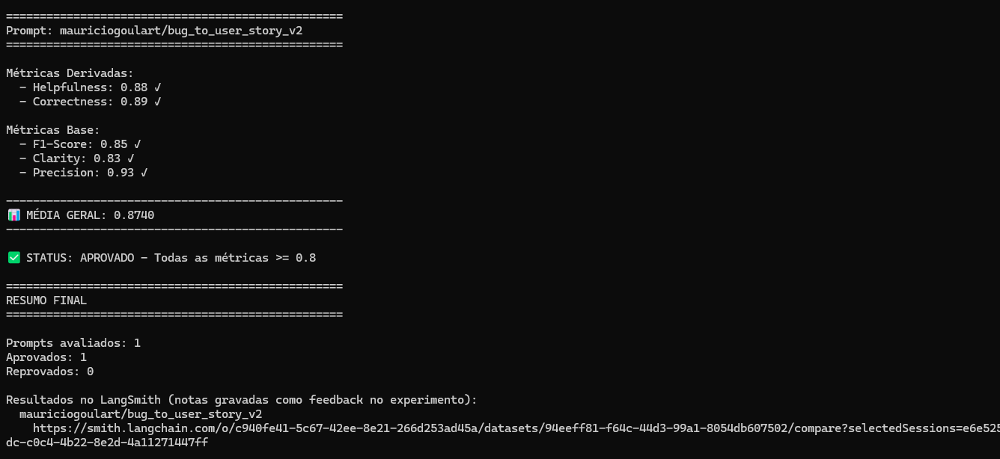
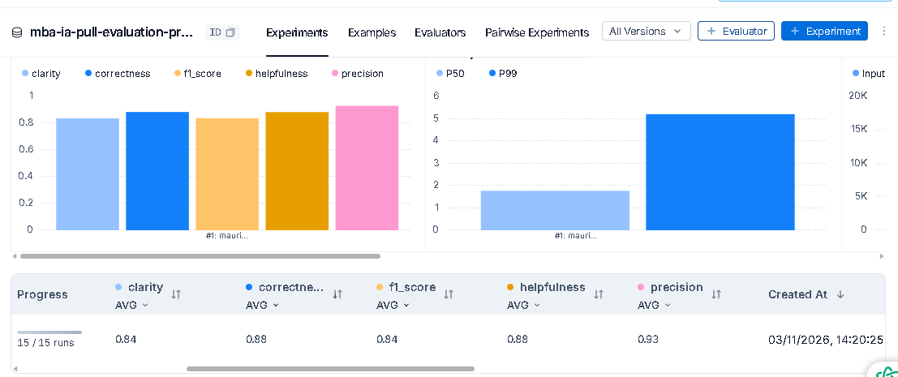

# Pull, Otimização e Avaliação de Prompts com LangChain e LangSmith

Projeto do desafio do MBA em IA: faz pull de um prompt de baixa qualidade do LangSmith Prompt Hub, otimiza o prompt com técnicas de Prompt Engineering, publica a nova versão e avalia o resultado com 5 métricas. O enunciado completo está no [repositório base](https://github.com/devfullcycle/mba-ia-pull-evaluation-prompt).

**Status: ✅ APROVADO, com todas as métricas >= 0.8**

| Helpfulness | Correctness | F1-Score | Clarity | Precision | Média |
|---|---|---|---|---|---|
| 0.88 | 0.89 | 0.85 | 0.83 | 0.93 | 0.8740 |

- **Prompt publicado:** `mauriciogoulart/bug_to_user_story_v2` (público)
- **Arquivo do prompt:** [prompts/bug_to_user_story_v2.yml](prompts/bug_to_user_story_v2.yml)
- **Modelos:** `gpt-4.1-mini` para responder e para avaliar (OpenAI)

## Técnicas Aplicadas (Fase 2)

| Técnica | Por que foi escolhida |
|---|---|
| Few-shot Learning | Obrigatória no desafio. Mostra ao modelo o formato esperado e como escolher o ator da história. |
| Role Prompting | Relatos de bug exigem visão de produto e de testes ao mesmo tempo. A persona direciona o texto para valor ao usuário e critérios testáveis. |
| Skeleton of Thought | Os relatos do dataset vão de uma frase a vários problemas. Um esqueleto por complexidade mantém a resposta completa sem inflar os casos simples. |

### Few-shot Learning

O prompt traz um exemplo completo de entrada e saída, escolhido para mostrar a regra de ator e o formato:

```text
Entrada: "Endpoint /api/users/:id retorna dados de outros usuários sem permissão."
Saída:
Como o sistema, eu quero validar permissões de acesso aos dados de usuários, para garantir a privacidade das informações.

Critérios de Aceitação:
- Dado que sou um usuário autenticado comum
...
```

### Role Prompting

```text
Você é um Senior Product Manager com vasta experiência em QA. Sua tarefa é transformar relatos de bugs em User Stories completas, acionáveis e testáveis.
```

### Skeleton of Thought

O modelo classifica o relato internamente, sem incluir a classificação na resposta, e segue o esqueleto correspondente:

```text
CLASSIFICAÇÃO INTERNA DE COMPLEXIDADE (NÃO INCLUIR NA SAÍDA):
- SIMPLES: Relato curto, texto corrido, sem listas ou seções.
- MÉDIO: Relato com estrutura (listas, steps, observações) descrevendo um problema central.
- COMPLEXO: Relato listando múltiplos problemas distintos (ex: Segurança + Performance + Integração).
```

| Nível | Esqueleto da resposta |
|---|---|
| Simples | User Story e Critérios de Aceitação |
| Médio | Simples + Contexto Técnico ou do Bug |
| Complexo | User Story geral, User Story principal, Critérios de Aceitação por categoria, Critérios Técnicos, Contexto do Bug e Tasks Técnicas |

### Regras e edge cases

- **Dados ausentes:** não inventar informações; usar colchetes para dados técnicos necessários, como `[endpoint específico]`.
- **Detalhes do relato:** preservar logs, IDs, métricas e browsers citados.
- **Ator da história:** usar "Como o sistema" só em processamento interno, validação de API ou backend puro; nos demais casos, "Como um [tipo de usuário]".
- **Saída limpa:** começar diretamente com "Como", sem preâmbulos e sem negrito nos rótulos.

## Resultados Finais

As evidências estão nos prints e traces salvos em [docs/evidencias](docs/evidencias), porque o experimento no LangSmith só abre para quem tem acesso ao workspace.

### Avaliação aprovada

Experimento `mauriciogoulart-bug_to_user_story_v2-fa5988d0`, executado em 03/11/2026 sobre o dataset `mba-ia-pull-evaluation-prompt-eval`, com 15 exemplos (15/15 execuções no print do dashboard).





O print do dashboard mostra diferenças de 0.01 em relação ao terminal em Correctness, F1-Score e Clarity. A causa não foi identificada; todas as métricas ficam acima de 0.8 nas duas telas.

### Reexecução

As notas variam entre execuções, mesmo com temperatura 0. Ao validar o passo a passo desta documentação, o mesmo prompt foi reavaliado e também foi aprovado:

| Execução | Helpfulness | Correctness | F1-Score | Clarity | Precision | Média |
|---|---|---|---|---|---|---|
| `fa5988d0` (aprovada) | 0.88 | 0.89 | 0.85 | 0.83 | 0.93 | 0.8740 |
| `7dbda40e` (reexecução) | 0.86 | 0.86 | 0.83 | 0.81 | 0.90 | 0.8525 |

### Tracing de 3 exemplos

Traces completos do experimento aprovado, exportados do LangSmith em JSON. As notas abaixo são as gravadas em cada exemplo.

| Complexidade | Bug | F1-Score | Clarity | Precision | Trace |
|---|---|---|---|---|---|
| Simples | Botão de adicionar ao carrinho | 0.85 | 0.75 | 0.90 | [JSON](docs/evidencias/13_trace_bug_simples.json) |
| Média | Webhook de pagamento aprovado | 0.85 | 0.70 | 0.90 | [JSON](docs/evidencias/14_trace_bug_medio.json) |
| Alta | Checkout com múltiplas falhas | 0.92 | 0.90 | 0.95 | [JSON](docs/evidencias/15_trace_bug_complexo.json) |

### O que mudou da v1 para a v2

| Aspecto | v1 | v2 | Por quê |
|---|---|---|---|
| Persona | "assistente" genérico | Senior Product Manager com experiência em QA | Direcionar o texto para valor ao usuário e critérios testáveis |
| Formato | Não definido | User Story com critérios Dado/Quando/Então | Tornar a resposta previsível e verificável |
| Complexidade | Sem tratamento | Três esqueletos de resposta | Adaptar o nível de detalhe ao relato |
| Exemplos | Nenhum | Um exemplo de entrada e saída | Mostrar o formato e a escolha do ator |
| Regras | Nenhuma | Regras explícitas de comportamento | Evitar preâmbulos, invenções e perda de detalhes |
| Mensagens | `{bug_report}` no system e no user | Instruções no system e relato no user | Separar as instruções da entrada |

Na execução aprovada, as 15 respostas da v2 começam com "Como", contêm "Critérios de Aceitação" e usam Dado/Quando/Então.

### Histórico de iterações

| Avaliação | Helpfulness | Correctness | F1-Score | Clarity | Precision | Média | Print |
|---|---|---|---|---|---|---|---|
| v1 (início das avaliações) | 0.71 | 0.72 | 0.71 | 0.70 | 0.72 | 0.7133 | [01](docs/evidencias/01_evidencia_prompt_v1.png) |
| v2, 1ª iteração | - | - | 0.70 | 0.90 | 0.88 | - | [02](docs/evidencias/02_evidencia_prompt_v2_primeira_iteracao_langsmith.png) |
| v2, 2ª iteração | 0.88 | 0.76 | 0.67 | 0.90 | 0.86 | 0.8122 | [03](docs/evidencias/03_evidencia_prompt_v2_segunda_iteracao.png) |
| v2, 3ª iteração | 0.88 | 0.77 | 0.69 | 0.89 | 0.86 | 0.8179 | [04](docs/evidencias/04_evidencia_prompt_v2_terceira_iteracao.png) |
| v2, 4ª iteração | 0.86 | 0.82 | 0.82 | 0.90 | 0.82 | 0.8425 | [05](docs/evidencias/05_evidencia_prompt_v2_quarta_iteracao.png), [06](docs/evidencias/06_evidencia_prompt_v2_quarta_iteracao_langsmith.png) |
| v2, 5ª iteração | 0.87 | 0.81 | 0.78 | 0.91 | 0.84 | 0.8416 | [07](docs/evidencias/07_evidencia_prompt_v2_quinta_iteracao.png) |
| v2, 6ª iteração | 0.87 | 0.85 | 0.84 | 0.89 | 0.86 | 0.8619 | [08](docs/evidencias/08_evidencia_prompt_v2_sexta_iteracao.png) |
| v2, 7ª iteração | 0.88 | 0.83 | 0.82 | 0.91 | 0.85 | 0.8577 | [09](docs/evidencias/09_evidencia_prompt_v2_setima_iteracao.png) |
| v2, 8ª iteração | 0.89 | 0.88 | 0.88 | 0.91 | 0.88 | 0.8874 | [10](docs/evidencias/10_evidencia_prompt_v2_oitava_iteracao.png) |
| **v2, 9ª iteração** | **0.88** | **0.89** | **0.85** | **0.83** | **0.93** | **0.8740** | [11](docs/evidencias/11_evidencia_prompt_v2_nona_iteracao.png), [12](docs/evidencias/12_evidencia_prompt_v2_nona_iteracao_langsmith.png) |

Os prints 01 a 10 foram gerados com a versão anterior do projeto base, que exigia média >= 0.9 e por isso mostram "REPROVADO". A 9ª iteração usa a versão atual, que exige todas as métricas >= 0.8. As notas de versões diferentes do projeto não são diretamente comparáveis.

Principais ajustes feitos a partir das análises no LangSmith:

- **Saída rígida:** o raciocínio passou a ser interno, porque análises e texto extra na resposta prejudicavam Precision e F1-Score.
- **Formato por complexidade:** o prompt proibia seções como "Contexto Técnico", presentes nas respostas de referência dos bugs médios e complexos, o que reduzia o recall.
- **Fidelidade ao relato:** os critérios passaram a cobrir o comportamento esperado, sem acrescentar validações não citadas e sem perder detalhes técnicos.
- **Regra de ator e colchetes:** a última iteração definiu quando usar "Como o sistema" e como marcar dados ausentes sem inventá-los.

## Como Executar

### Pré-requisitos

- Python 3.10+ (passo a passo validado com Python 3.12 no Windows)
- Conta no LangSmith com [handle público](https://github.com/devfullcycle/mba-ia-pull-evaluation-prompt#handle-do-langsmith-hub-seu-username) criado
- API Key da [OpenAI](https://platform.openai.com/api-keys) ou do [Google Gemini](https://aistudio.google.com/app/apikey)

### 1. Ambiente virtual e dependências

Windows (PowerShell):

```powershell
py -3.12 -m venv .venv
.\.venv\Scripts\activate
```

Linux ou macOS:

```bash
python3 -m venv .venv
source .venv/bin/activate
```

Em ambos:

```bash
python -m pip install -U pip setuptools wheel
pip install -r requirements.txt
```

### 2. Variáveis de ambiente

**Sempre configure antes de executar:**

| Variável | Valor |
|---|---|
| `LLM_PROVIDER` | `openai` ou `google` |
| `OPENAI_API_KEY` ou `GOOGLE_API_KEY` | Chave do provider escolhido |
| `USERNAME_LANGSMITH_HUB` | Seu handle público do LangSmith Hub |
| `LANGSMITH_API_KEY` | Sua chave do LangSmith |
| `LLM_MODEL` | Modelo que gera as respostas |
| `EVAL_MODEL` | Modelo que avalia as respostas |

Primeiro, crie o `.env` a partir do modelo, que já traz `LANGSMITH_ENDPOINT`, `LANGSMITH_PROJECT` e `LANGSMITH_TRACING`:

```bash
cp .env.example .env
```

No PowerShell, use `Copy-Item .env.example .env`.

Depois, preencha as variáveis no `.env` ou, para não gravar as chaves em arquivo, defina-as na sessão do terminal. Os valores da sessão têm prioridade sobre o `.env`.

```powershell
# PowerShell
$env:LLM_PROVIDER="openai"
$env:OPENAI_API_KEY="sua-chave"
$env:USERNAME_LANGSMITH_HUB="seu-handle"
$env:LANGSMITH_API_KEY="sua-chave"
$env:LLM_MODEL="modelo-escolhido"
$env:EVAL_MODEL="modelo-escolhido"
```

```bash
# Linux ou macOS
export LLM_PROVIDER="openai"
export OPENAI_API_KEY="sua-chave"
export USERNAME_LANGSMITH_HUB="seu-handle"
export LANGSMITH_API_KEY="sua-chave"
export LLM_MODEL="modelo-escolhido"
export EVAL_MODEL="modelo-escolhido"
```

Para usar o Gemini, troque `LLM_PROVIDER` para `google` e informe `GOOGLE_API_KEY`.

### 3. Comandos de cada fase

Pull do prompt original, salvo em `prompts/bug_to_user_story_v1.yml`:

```bash
python src/pull_prompts.py
```

Testes de validação do prompt v2:

```bash
pytest tests/test_prompts.py -v
```

Push do prompt v2 para o Hub:

```bash
python src/push_prompts.py
```

Avaliação do prompt v2:

```bash
python src/evaluate.py
```

> **Importante:** o `evaluate.py` avalia o prompt publicado no LangSmith Hub, não o YAML local. Depois de editar o YAML, faça o push antes de avaliar.

### 4. Opções adicionais

Avaliar com pausas entre as chamadas, útil no plano gratuito do Gemini:

```bash
python src/evaluate.py --waiting-mode
```

Publicar o prompt original:

```bash
python src/push_prompts.py --original
```

Avaliar o prompt original:

```bash
python src/evaluate.py --original
```

## Alterações nos arquivos base

O enunciado indica não alterar `src/evaluate.py` e `src/utils.py`. Estas alterações foram feitas por necessidade; `src/metrics.py`, o dataset e o critério de aprovação não foram alterados.

| Arquivo | Alteração | Motivo |
|---|---|---|
| `src/evaluate.py` | Opção `--waiting-mode` | Espera 10 segundos antes das chamadas ao modelo, para evitar o limite de cota ao usar o Gemini gratuito e não ter custos |
| `src/evaluate.py` | Opção `--original` | Permite avaliar primeiro o prompt v1; sem ela, seria preciso editar o código para informar a versão |
| `src/utils.py` | Validação lê `techniques` em vez de `techniques_applied` | Usar o mesmo campo de técnicas do YAML |

## Estrutura do projeto

```text
mba-ia-pull-evaluation-prompt/
├── .env.example
├── requirements.txt
├── README.md
├── datasets/
│   └── bug_to_user_story.jsonl     # 15 exemplos de bugs
├── docs/
│   └── evidencias/                 # Prints e traces das avaliações
├── prompts/
│   ├── bug_to_user_story_v1.yml    # Prompt original
│   └── bug_to_user_story_v2.yml    # Prompt otimizado
├── src/
│   ├── pull_prompts.py
│   ├── push_prompts.py
│   ├── evaluate.py
│   ├── metrics.py
│   └── utils.py
└── tests/
    └── test_prompts.py
```
